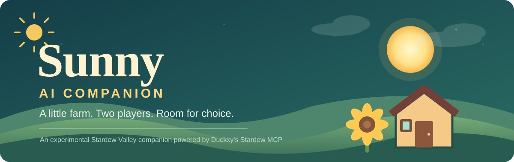

<p align="right">🌐 <a href="README.md">ภาษาไทย</a> · <b>English</b></p>

<div align="center">
  

# 🌻 Sunny — AI Companion for Stardew Valley

**Exploring an AI farm companion with room to make its own choices**

*Guy is the human player (P1). Sunny is an AI-controlled farmhand (P2).*

**Work in progress · Personal experimental fork · Not a standalone release**

</div>

> **This is a fork of [Duckxy's Stardew MCP](https://github.com/duckxy166/stardew-ai-agent)**, not a new mod built from scratch, and not an official release from the original developer. The cover artwork above was created specifically for Sunny.

## ☀️ Meet Sunny

Sunny is a Stardew Valley farmhand sharing a farm with Guy. The project uses Duckxy's MCP/HTTP interface to connect the game to an AI decision-maker nicknamed **Luna**. The goal isn't just optimal farming: it's to explore a companion that can observe, choose activities, react to events, and coexist with a human player.

The intended loop is **observe → decide → act → verify → continue**. Sunny should be free to do things, remain idle, or chat when it makes sense, rather than follow a fixed number of daily activities or mandatory conversations.

## 🧪 What has been verified

| Capability | Status |
| --- | --- |
| Control Sunny (P2) through Stardew MCP | ✅ Used in a test save |
| Walk to a selected tile | ✅ Tested in game |
| Sit down and stand up from an Oak Chair with `interact` | ✅ Tested in game — [PR #1 merged](https://github.com/niabchan/stardew-ai-agent/pull/1) |
| Continue to another activity (watching the TV weather report) after standing | ✅ Tested in game |
| Perform multiple activities per day without a 09:00 restriction | ✅ Explored using Free Play v0.2, **a separate local prototype** |
| Automatically check the morning state and act without a manual command | 🚧 Planned |
| Fully autonomous, persistent and socially aware gameplay | 🚧 Longer-term goal |

These results come from an experimental farm day 20. They are not evidence that every game situation is supported.

## 🧩 What's in this project?

- **Duckxy's Stardew MCP** — the underlying game mod, action tools, and MCP/HTTP API
- **This fork (`niabchan/stardew-ai-agent`)** — game-side improvements tested for Sunny, including the chair-exit fix
- **Sunny Free Play / PowerShell / Python prototypes** — separate experimental companion scripts **not committed to this repository**; cloning this repo alone does **not** provide `Start-SunnyCompanion.ps1`
- **Luna** — the nickname for the AI decision-maker, not a separate model or product

## 🔧 Getting started

To **install the original Stardew MCP mod**, follow [Duckxy's documentation](https://github.com/duckxy166/stardew-ai-agent/blob/main/README.en.md#install). You'll need Stardew Valley 1.6+ and SMAPI 4.0+.

To **inspect or compile this fork** on a computer with Stardew Valley installed:

```powershell
git clone https://github.com/niabchan/stardew-ai-agent.git
cd stardew-ai-agent
dotnet build .\mod\StardewMCP\StardewMCP.csproj -c Release -p:EnableModDeploy=false -p:EnableModZip=false
```

This is a **compile-only build**, without automatic mod deployment. Back up your installed mod and test save before experimenting, and never commit save files, logs, or API keys.

Additional context: [SUNNY_COMPANION.md](SUNNY_COMPANION.md) · [Stardew MCP tools](docs/tools.md) · [HTTP API](docs/api.md) · [Contributing](CONTRIBUTING.md)

## 📝 Current limits

The chair-exit change passed compilation and local gameplay testing. A separate C# unit test for system-prompt placeholder replacement remains red (267/268 passed), outside the chair code path. Python tests reported 86 passed, 7 skipped and 1 expected failure. Some tool results and later position snapshots disagree briefly, which still requires investigation.

**Free Play is not yet a fully automatic gameplay loop**; the local prototype can perform multiple actions, but it still needs a caller to start each choice.

## 💚 Credits and license

With thanks to **[Duckxy](https://github.com/duckxy166/stardew-ai-agent)** for Stardew MCP and its core game integration, and to the earlier [Hunter-Thompson/stardew-mcp](https://github.com/Hunter-Thompson/stardew-mcp) project credited in upstream's history.

This fork retains the original [MIT License](LICENSE). It is a fan-made experiment, not affiliated with ConcernedApe or officially endorsed by Stardew Valley.

**[Duckxy's original project](https://github.com/duckxy166/stardew-ai-agent) · [Sunny project notes](SUNNY_COMPANION.md) · [Chair-toggle PR](https://github.com/niabchan/stardew-ai-agent/pull/1)**
