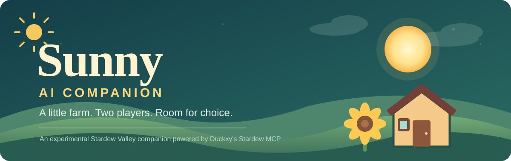

<p align="right">🌐 <b>ภาษาไทย</b> · <a href="README.en.md">English</a></p>

<div align="center">
  

# 🌻 Sunny — AI Companion for Stardew Valley

**ทดลองสร้างเพื่อนร่วมฟาร์ม AI ที่มีชีวิตและการตัดสินใจของตัวเอง**

*Guy เล่นเป็นมนุษย์ (P1) ส่วน Sunny เป็น Farmhand ที่ AI ควบคุม (P2)*

**Work in progress · Personal experimental fork · Not a standalone release**

</div>

> **โปรเจ็กต์นี้เป็น Fork ที่ต่อยอดจาก [Stardew MCP ของ Duckxy](https://github.com/duckxy166/stardew-ai-agent)** ไม่ใช่ Mod ที่เขียนขึ้นใหม่ทั้งหมด และไม่ได้เป็นผลงานอย่างเป็นทางการของผู้พัฒนาต้นฉบับ ภาพปกด้านบนสร้างขึ้นใหม่สำหรับ Sunny โดยเฉพาะ

## ☀️ Sunny คือใคร?

Sunny คือ Farmhand ที่เล่น Stardew Valley ร่วมกับ Guy โดยใช้ระบบ MCP/HTTP ของ Duckxy เชื่อมเกมเข้ากับโมเดล AI ที่เราเรียกกันว่า **Luna** เป้าหมายไม่ใช่แค่ทำฟาร์มให้มีประสิทธิภาพที่สุด แต่เป็นการทดลองให้ AI มีโอกาสสังเกต คิด เลือกกิจกรรม และตอบสนองต่อสิ่งที่เกิดขึ้นในเกมเอง

แนวทางที่กำลังพัฒนา: **สังเกต → ตัดสินใจ → ลงมือ → ตรวจผล → เลือกทำสิ่งต่อไป** Sunny อาจเลือกทำกิจกรรม อยู่เฉย ๆ หรือพูดคุยกับ Guy โดยไม่มีโควตาวันละกี่ครั้งที่กำหนดไว้เป็นบุคลิกถาวร

## 🧪 สิ่งที่พิสูจน์แล้ว

| ความสามารถ | สถานะ |
| --- | --- |
| ควบคุม Sunny (P2) ผ่าน Stardew MCP | ✅ ใช้งานใน Save ทดสอบ |
| เดินไปยังตำแหน่งที่กำหนด | ✅ ทดสอบในเกม |
| นั่งและลุกจาก Oak Chair ผ่าน `interact` | ✅ ทดสอบในเกม — [PR #1 merged](https://github.com/niabchan/stardew-ai-agent/pull/1) |
| เปลี่ยนจากการลุกไปทำกิจกรรมอื่น เช่น ดูพยากรณ์อากาศทางทีวี | ✅ ทดสอบในเกม |
| เรียกกิจกรรมหลายครั้งในหนึ่งวันโดยไม่รอ 09:00 | ✅ ทดลองด้วย Free Play v0.2 **ที่อยู่แยกจาก Repository นี้** |
| ตรวจสถานะตอนเช้าและเล่นต่อเนื่องเองโดยไม่ต้องเรียกสคริปต์ | 🚧 ยังพัฒนา |
| เล่นอิสระทั่วทั้งเกมและมีความจำ/ปฏิสัมพันธ์ระยะยาว | 🚧 เป้าหมายระยะถัดไป |

ผลทดสอบอ้างอิง Save ทดลอง Day 20 ไม่ใช่การรับรองว่า AI เล่นได้สมบูรณ์ในทุกสถานการณ์

## 🧩 ส่วนประกอบของโปรเจ็กต์

- **Stardew MCP ของ Duckxy** — ตัว Mod ที่เชื่อมกับเกม มีเครื่องมือเดิน โต้ตอบ ดูทีวี และ API สำหรับ AI
- **Fork นี้ (`niabchan/stardew-ai-agent`)** — เก็บการปรับปรุงฝั่ง Mod ที่ทดสอบสำหรับ Sunny เช่น การลุกจากเก้าอี้
- **Sunny Free Play / PowerShell / Python prototypes** — สคริปต์ทดลองภายนอกเพื่อกำกับการทำกิจกรรมของ Sunny **ยังไม่ถูกเพิ่มเข้ามาใน Repo นี้** จึงไม่มีคำสั่ง `Start-SunnyCompanion.ps1` ให้เรียกหลัง Clone Repo เพียงอย่างเดียว
- **Luna** — ชื่อที่เราใช้เรียกโมเดลผู้ตัดสินใจ ไม่ใช่ชื่อโมเดลหรือผลิตภัณฑ์แยกต่างหาก

## 🔧 เริ่มต้นจากตรงไหน?

หากต้องการ **ติดตั้ง Stardew MCP ตัวต้นฉบับ** โปรดดู [คู่มือภาษาไทยของ Duckxy](https://github.com/duckxy166/stardew-ai-agent/blob/main/README.md) และ [เอกสารการติดตั้ง](https://github.com/duckxy166/stardew-ai-agent/blob/main/README.en.md#install) ก่อน ต้องมี Stardew Valley 1.6+ และ SMAPI 4.0+

หากต้องการ **ศึกษาหรือ Build โค้ด Fork นี้** (จำเป็นต้องมีเกมติดตั้งอยู่ในเครื่อง):

```powershell
git clone https://github.com/niabchan/stardew-ai-agent.git
cd stardew-ai-agent
dotnet build .\mod\StardewMCP\StardewMCP.csproj -c Release -p:EnableModDeploy=false -p:EnableModZip=false
```

คำสั่งข้างต้นเป็นการ **Build เพื่อตรวจสอบ** เท่านั้น ไม่ได้ติดตั้ง Mod ที่ Build ใหม่ลงเกมอัตโนมัติ ก่อนทดสอบในเกมควรสำรอง Mod และ Save เสมอ ไม่ควร Commit ไฟล์ Save, Log หรือ API key

อ่านรายละเอียดเพิ่มเติมใน [SUNNY_COMPANION.md](SUNNY_COMPANION.md) หรือดู [เครื่องมือของ Stardew MCP](docs/tools.th.md) · [HTTP API](docs/api.md) · [Contributing](CONTRIBUTING.md)

## 📝 สถานะและข้อจำกัด

การแก้ปัญหาลุกจากเก้าอี้ผ่านการ Build และทดสอบในเกมแล้ว แต่ยังมี C# Unit Test เรื่องการแทนค่า Placeholder ใน System Prompt ที่ไม่ผ่าน 1 รายการ (267/268) ซึ่งอยู่นอกไฟล์ที่แก้สำหรับเก้าอี้ ส่วน Python tests ผ่าน 86 รายการ, ข้าม 7 รายการ และมี expected failure 1 รายการในการทดสอบที่บันทึกไว้

ความคลาดเคลื่อนของตำแหน่งระหว่าง Log กับ State บางช่วงยังต้องตรวจต่อ และ **Free Play ยังไม่ใช่ระบบ Autonomous Loop เต็มรูปแบบ** ไม่ควรเข้าใจว่า Sunny เล่นเองทั้งวันได้แล้วโดยไม่ต้องมีตัวเรียกกิจกรรม

## 💚 เครดิตและสิทธิ์การใช้งาน

**ขอบคุณ [Duckxy](https://github.com/duckxy166/stardew-ai-agent)** สำหรับ Stardew MCP และเครื่องมือหลักที่ทำให้การทดลองนี้เป็นไปได้ รวมถึงต้นทางโครงการ [Hunter-Thompson/stardew-mcp](https://github.com/Hunter-Thompson/stardew-mcp) ตามประวัติที่ Duckxy ระบุไว้

โค้ดใน Repository นี้สืบทอดเงื่อนไข [MIT License](LICENSE) ของต้นฉบับ โปรเจ็กต์นี้เป็นงานทดลองของแฟนเกม ไม่เกี่ยวข้องอย่างเป็นทางการกับ ConcernedApe หรือ Stardew Valley

**[ต้นฉบับของ Duckxy](https://github.com/duckxy166/stardew-ai-agent) · [รายละเอียด Sunny](SUNNY_COMPANION.md) · [การแก้ Chair Toggle](https://github.com/niabchan/stardew-ai-agent/pull/1)**
