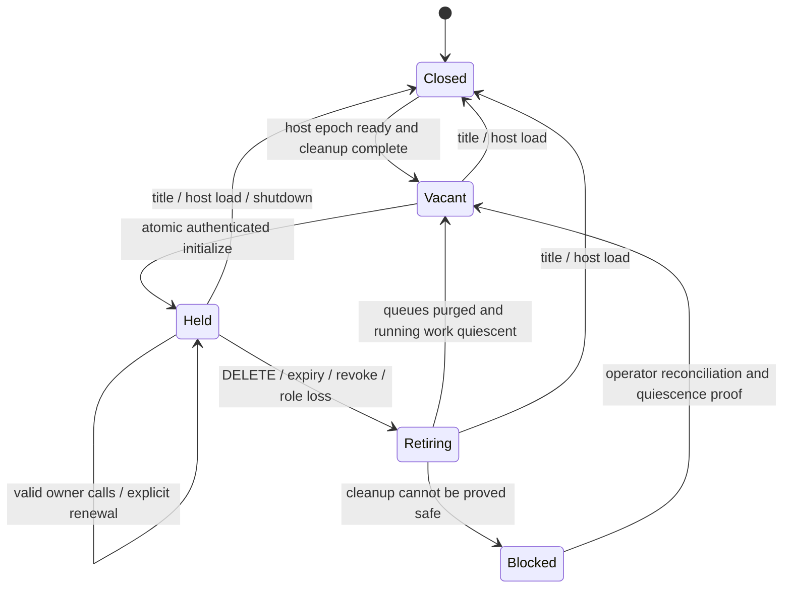

# Sunny P2 server authentication, ownership and save-epoch contract

> 2026-11-07 · Issue #27 · **D: documentation-only design for independent review.**
> No listener security, cancellation, credential provisioner or recovery protocol is
> implemented by this report. Guy remains human P1; Sunny is AI P2, driven by Luna.
> Target: `docs/sunny-controller-client-compatibility`, never `main`.

## Evidence and scope

**S** means verified checked-in source, not installed behavior. **D** means proposed
behavior; all normative requirements below are D unless marked S. **U** means
unverified client, game, OS or browser behavior. Tool acknowledgment, observed
world effect, persisted save and model narrative remain different evidence.

Source baseline is prepared branch commit
`60298f8a78ff759d9b7c80cc2a447c5d20898bf5`. PR #26 was separately inspected at
`98319b260a0919ccd6f0193daf29e0fd306fafaa`; its files are not in the prepared
branch. References to those files use that immutable commit, not a claim that
this PR imports or merges them.

Required prior designs read: [PR #19 boundary](HTTP_MCP_SECURITY_BOUNDARY.md),
[security review](HTTP_MCP_SECURITY_REVIEW.md), [PR #21 fake fixtures](SECURITY_POLICY_FIXTURES.md),
[PR #22 compatibility](HTTP_MCP_CLIENT_COMPATIBILITY.md),
[PR #23 ownership](P2_CONTROLLER_LIFECYCLE_REVIEW.md),
[PR #24 browser design](BROWSER_OBS_READONLY_ACCESS_DESIGN.md), and
[PR #25 sanitized audit](SUNNY_V0311_HTTP_MCP_TRANSPORT_AUDIT.md).
The latter establishes findings about a supplied v0.3.11 archive only. The private
ZIP and current installed Luna sources were not accessed here; installed version
and behavior remain U. No secrets, saves, operator logs or installed DLLs were read.

### Verified source index (S)

Agent paths below are relative to `mod/StardewMCP/Agent/`; line references are at
the baseline. Function names disambiguate references for future implementations.

| Ref | Inspected source and finding |
| --- | --- |
| S1 | [AgentHttp.cs](../../mod/StardewMCP/Agent/AgentHttp.cs):66–81 `Start`, 98–229 `Handle`, 306–318 `HandleMcp`: localhost/127.0.0.1 prefixes, wildcard CORS, no application auth; MCP role routing; DELETE empty 200 without teardown; whole-body read then break observation/deadline assignment before dispatcher. |
| S2 | [McpDispatcher.cs](../../mod/StardewMCP/Agent/McpDispatcher.cs):62–118 `Handle`/`Dispatch`: sequential batches, contact before shape checks, predictable single-response session, no incoming session check or initialize prerequisite, version echo, JSON results and empty 202 notifications. |
| S3 | [McpSeat.cs](../../mod/StardewMCP/Agent/McpSeat.cs):17–29: real contact adapter and `EnqueueCall(... observation:true)`; text/isError/optional structured result conversion, no security context. |
| S4 | [AgentRuntime.cs](../../mod/StardewMCP/Agent/AgentRuntime.cs):14–25, 103–130, 225–280, 286–397: unfenced pending calls, two unbounded queues; `AnswerQueued` only answers action queue; lane start and coroutine steps lack ownership/epoch guard. Interrupt disposes stacks; ordinary Finish consumes mail, annotates breaks, updates stats/logs and adds current-world status. Early reply is not coroutine termination. |
| S5 | [Players.cs](../../mod/StardewMCP/Agent/Players.cs):26–84, 184–249: logical slots survive role resolution, contact changes connection/timeout/release; unknown roles fall through to AI, P1 off/camera coerces to AI. Logical-seat binding is distinct from ownership. |
| S6 | [SessionBreaks.cs](../../mod/StardewMCP/Agent/SessionBreaks.cs):36–100, 165–186: static per-seat context counters; initialize marks Fresh and can arm breaks; no security lease/epoch. |
| S7 | [WorldClock.cs](../../mod/StardewMCP/Agent/WorldClock.cs):46–102 `Tick`/`IsThinking`: eligible connected AI may freeze; thinking timeout, night/wakeup exclusions and operator hold are separate. Contact alone does not reset the stopwatch. |
| S8 | [ModEntry.cs](../../mod/StardewMCP/ModEntry.cs):49–63, 95–114, 116–159: listener survives title/load; SaveLoaded also runs on farmhand screens, host role/brain startup follows ScreenId check; no security epoch coordinator. |
| S9 | [ModConfig.cs](../../mod/StardewMCP/Agent/ModConfig.cs):10–32, 45–64, 81: default AI roles, Brain none, padded seat config, default port 8770. `Brain=none` is not authorization. |
| S10 | [overlay.html](../../mod/StardewMCP/assets/overlay.html):657–685; [replay.html](../../mod/StardewMCP/assets/replay.html):150, 209–246: unauthenticated aggregate reads; same-origin selected only on port 8770, otherwise fallback to localhost:8770. Display seat filters do not filter transmitted data. |
| S11 | [FakeSecurityBoundary.cs](../../mod/StardewMCP.Tests/FakeSecurityBoundary.cs) `Handle`/`ExecuteNext` and [SecurityBoundaryTests.cs](../../mod/StardewMCP.Tests/SecurityBoundaryTests.cs): sequential synthetic policy, status-only simulated queue, no real listener or running game actions. |
| S12 | PR #26 [adapter.py](https://github.com/niabchan/stardew-ai-agent/blob/98319b260a0919ccd6f0193daf29e0fd306fafaa/reference/sunny_transport/adapter.py), `GameTransport`; [README](https://github.com/niabchan/stardew-ai-agent/blob/98319b260a0919ccd6f0193daf29e0fd306fafaa/reference/sunny_transport/README.md), [REVIEW](https://github.com/niabchan/stardew-ai-agent/blob/98319b260a0919ccd6f0193daf29e0fd306fafaa/reference/sunny_transport/REVIEW.md), [tests](https://github.com/niabchan/stardew-ai-agent/blob/98319b260a0919ccd6f0193daf29e0fd306fafaa/mod/tests/test_sunny_transport_adapter.py): offline exchange callback only; fences every attempted release, including plausible acknowledgment bodies. |

## Chosen threat boundary and route/grant matrix (D)

Protect P1 privacy/control, P2 authority, shared-world integrity, private journals
and game/provider credentials from hostile webpages, wrong instances, stale
controllers, LAN peers and untrusted native clients. Loopback is a transport
restriction, absent Origin is not identity, and CORS is not authentication.
Malicious same-user processes that can read credentials or inject into the game
may be indistinguishable from the authorized client; this design claims no OS
isolation against them. P2 tools can affect shared resources without controlling P1;
per-tool resource/consent policy remains necessary.

Independent grants (no implicit hierarchy): **C** P2-control; **O** P2-observe with
separate human-consent record for P1 safety; **A** operator controls with explicit
subscopes; **H** watchdog; **R** private replay seat/day/field scopes; **V** opt-in
published viewer. C is not automatically O, R, A or V. Provision C+O for the native
pilot explicitly. **No P1 automation grant exists.** Unrelated upstream AI seats
may retain separate ownership; this profile exclusively coordinates P2, not every
AI seat globally. This narrows earlier “one controller per save” wording to one
Sunny P2 controller per save epoch.

| Actual route/method behavior (S1) | Proposed allowed methods and grants (D) | Denial / exposure boundary |
| --- | --- | --- |
| `/mcp/p2` POST; DELETE no-op; others 405 when AI route exists | POST C initialize/tools; POST O+C session status; DELETE C retirement | Explicit P2 only; GET/SSE unsupported 405. All calls after initialize require owner/session/epoch. |
| `/mcp` aliases P1; `/mcp/p1`; other seat MCP routes | Sunny grants denied; human P1 routes 404 | No default-seat alias or grant escalation; independent upstream AI seat policy cannot authorize P1 in Sunny mode. |
| `/api/state` no method guard | GET A `raw-state` exceptional private scope only | C/O/H/R/V 403; host paths/dialogue/resources and all-seat data never become pilot observations. |
| `/api/feed`, `/api/days`, `/api/day?n=`, `/api/memory` no method guard | GET A explicit `raw-history` only; R uses projected replacement routes | No raw feed/day/memory to native pilot or viewer; raw operator scope is separately approved, not implied by A control. |
| `/api/briefing`, `/api/relationships`, `/api/stats` no method guard | GET A explicit private-read scope | Future O projected P2 variants require separate schemas; no missing-seat fallback to P1. |
| `/api/control` GET flags / POST actions | GET/POST A `run-control` | Explicit command enum, no automation role changes; watchdog cannot stop/restart. |
| `/api/meta` POST dictionary/log mutation | POST A `metadata` | Allowlisted bounded display metadata only, no arbitrary event logging. |
| `/api/release_freeze` POST | POST A `release:p2`; `all` separate operator scope | C/H cannot release arbitrary seats or operator hold. |
| `/api/debug/{op}`, `/api/debug/pN/{op}` config-gated POST | POST A temporary `debug:p2` plus EnableDebugApi | Default off; no P1 targeting or default host. Enumerate allowed ops and validate args; unknown op 404. |
| `/`, `/replay`, `/overlay` assets served without method guard | GET authorized private shell or explicitly published viewer shell | Assets contain no credentials/private bootstrap data; private replay data requires R. |
| Proposed `/api/health/v1` | GET H | Minimal health only, no MCP/contact or acquisition. |
| Proposed `/api/companion/v1/p2/safety` | GET O plus valid P2 owner/session/epoch | Consent-aware typed projection below; no public viewer access. |
| Proposed `/api/replay/v1/{config,days,day,memory}` | GET R exact seat/day/field intersection | Server projects nested text before serialization; no legacy P1 diary alias, paths or implicit memory access. |
| Proposed `/api/view/v1/{config,feed,summary}` | GET V only if explicitly published | Sanitized public text, projection-local cursor/counts; default excludes thoughts, diaries, notes, args/results and P1 text. |
| Proposed `/api/companion/v1/p2/lease` and `/operations/{id}` | GET C bound owner/session/epoch; retirement status also allowed for matching tombstone | Recovery metadata only; no dispatch, arguments, dialogue or foreign owner disclosure. |

All unlisted paths 404; known methods outside allowlist 405 with Allow; HEAD is
unsupported, not an accidental read shortcut. Native OPTIONS returns 405 without
effects; browser read surfaces may return narrowly validated OPTIONS 204. Canonical
paths only: reject encoded separators, ambiguous normalization, duplicate query or
security headers (400), rather than routing around a scope check.

The first pilot requires **no OBS broker**. Disable viewer publication until
needed. Later choose the read-only broker option in PR #24, holding only V and
serving deliberately public sanitized content; private replay stays separate.
Neither OBS, replay nor OpenAI receives the controller bearer. Existing browser
assets require migration before enforcement, not a hidden no-auth exception.

## Native provisioning, instance identity and browser rules (D/U)

A local operator-owned provisioner creates a 256-bit random game credential,
stores only its verifier and scope/expiry/revocation metadata at the server, and
hands the client the secret through an authenticated OS-protected named pipe or
inherited restricted handle. Native pairing uses an operator-approved UI and
OS identity/ACL checks, not an unauthenticated HTTP minting route. A restricted
credential-store entry is a fallback; fail closed if storage/ACL verification is
unavailable. Do not pass tokens through URLs/fragments, CLI args, environment dumps,
JS/localStorage, model prompts, source files, console/chat or logs. Redact request
headers/bodies and disable redirect forwarding; never inspect real tokens for tests.
Windows ACL, pipe impersonation and credential-store properties are U until tested.

Provisioning binds the credential to a random server-instance ID, configured
scheme/host/port, P2, allowed scopes and an expiry. The client receives the expected
instance ID through that trusted channel. Server restart creates a new instance
and invalidates old sessions; re-pair explicitly. First initialize returns the
instance ID in `result._meta.sunny.instanceId`; the client must compare it to the
provisioned expectation before using the lease. Epoch alone cannot authenticate
the intended instance. Unique per-instance credentials cause a wrong server to
reject 401; a header on a hostile server is not cryptographic identity. Plain HTTP
loopback relies on trusted local routing/OS; stronger local-adversary guarantees
require reviewed IPC or pinned local TLS, not bearer marketing.

Validate actual peer is loopback (including intentional IPv4-mapped IPv6 policy),
not forwarded headers. Accept only exact configured authorities `localhost:PORT`
and `127.0.0.1:PORT`; enable `[::1]:PORT` only after binding tests. Reject extra Host,
userinfo, wrong port, unconfigured names and DNS-rebinding hosts. Never fall back
between ports 8770 and 18770 or between instances. localhost and 127.0.0.1 are
separate allowed origins; choose one per client configuration. No redirects.

Native C/O/A/H requests deny **any** Origin, including null, empty, same-origin,
multiple and malformed Origin (403). No-Origin clients still need bearer auth;
forged/absent Origin provides no trust. Protected responses have no wildcard CORS,
`Cache-Control: no-store` and no sensitive errors. Browser R sessions use the
separate PR #24 same-origin authenticated pairing design (HttpOnly host-only
Secure SameSite cookie under tested local HTTPS), not the native bearer. Cookie
ports are not isolated; separate private session stores/origins. Browser mutations,
if added, require exact Origin plus session-bound CSRF header and JSON media type;
no-Origin mutations denied. SameSite/CORS alone cannot stop simple POST submission.
Published V reads are intentionally readable only as published material; arbitrary
cross-origin private access and `file:`/null-Origin private access remain denied.
Same-origin relative API URLs at every port replace the legacy 8770 fallback.

## Wire profile and admission ordering (D)

Name this profile `sunny-p2/1`, MCP protocol allowlist initially **2025-06-18 only**
(to match S12). Validate initialize `params.protocolVersion` against that set;
unsupported version returns HTTP 400 / -32602 before acquisition, with supported
versions in non-sensitive error data. Do not echo arbitrary versions. Future MCP
versions require explicit compatibility tests and profile review. Optional
`MCP-Protocol-Version` on subsequent HTTP requests must match the negotiated
version if present; omission is allowed for the PR #26 profile. JSON only: advertise
no SSE, streaming, server-initiated requests or unsupported capabilities.

Ordering:

1. Provision distinct C+O credentials and expected instance/origin out of band.
2. POST `/mcp/p2` initialize, Authorization bearer, Content-Type application/json,
   Accept application/json (also accept a list containing it), no session/epoch.
   Validate everything before atomic acquisition. Reply 200 JSON-RPC result with
   protocolVersion, tools capability, serverInfo and `_meta.sunny` containing
   profile, instanceId, ownerId (opaque per lease), leaseSeconds and recovery policy.
   Headers `Mcp-Session-Id` and `X-Sunny-Save-Epoch` are unpredictable, unique and
   printable ASCII <=128 characters. Never `stardew-p2`. Session is not a bearer.
3. Optional `notifications/initialized` with auth/session/epoch returns **202 empty**.
   It is idempotent and has no contact/clock/counter effects. It is not required
   before tool calls in this profile: this explicitly accommodates S12's omission.
4. ping and tools/list require auth/session/epoch, return 200 normal RPC and do not
   acquire/renew ownership or change gameplay state. Only explicit lease activity
   below renews; discovery cannot hold a vacant seat or freeze the world.
5. tools/call requires all three headers; server independently validates tool and
   argument schema and scope. Successful accepted calls preserve `content`, boolean
   `isError`, optional `structuredContent` with no replacement transport envelope.
   Tool failure remains HTTP 200 result isError=true; it may represent partial
   effects. JSON-RPC id is correlation, never action deduplication.
6. DELETE `/mcp/p2` has empty body and all three headers; retirement described below.

Header names are case-insensitive; duplicate case variants are invalid. Every
successful native session response, including 202 and safety GET, echoes the
admitted epoch; initialize and DELETE additionally echo session. Epoch also appears
in safety JSON and authorized health/replay read projections. Never rewrite an
old completion with the current epoch. On stale-epoch errors do not disclose new
world state; fresh provisioning/acquisition determines the new epoch.

**Batch decision:** v1 rejects every array, including singleton/notification-only
arrays, HTTP 400 / -32600, before any element dispatch. This is a deliberate
compatibility change from S2 and an alternative to S11's atomic batch fixture.
If later supported, validate the entire batch and atomically reserve all capacity;
initialize cannot mix with actions, and a malformed tail admits nothing. Admission
atomicity does not mean rollback of independent tool effects. Mutation notifications
are unsupported; only initialized notification is accepted. Other id-less requests
return HTTP 400 with no RPC body and no effects (no JSON-RPC reply to a notification).

### Preflight, budgets and error matrix

Before `SessionBreaks.Observe`, deadline assignment, MarkContact, protected reads,
meta/log/control changes or queue insertion: (a) bound connections and validate
peer/authority/path/Origin/header shape; (b) authenticate and route-authorize;
(c) validate method/media/query and read body with limits; (d) parse whole strict
JSON/envelope/schema; (e) under coordinator lock validate instance/epoch/session,
role/binding/grant validity and reserve queue budget. Recheck relevant predicates
at commit. Denial may charge only security rate/audit counters with redacted reason,
never gameplay logs, contact, break counters or protected projections.

Proposed initial bounded defaults, to tune only through synthetic measurement:
16 KiB UTF-8 request, depth 32, 5s body-read deadline, 256 KiB response, 8 concurrent
requests per principal / 32 global, 4 pending actions and 8 pending observations
per P2 lease; 10 requests/s burst 20 per principal and separate global admission
budget. Reserve retirement/health capacity so a 1200s action cannot starve cleanup.
JSON forbids duplicate keys/nonfinite values; ids are non-null strings 1..64 chars
or integers within ±(2^53−1), excluding bool/fractions. Tool arguments obey checked
schemas including unknown-property policy. Unknown tools rejected -32602 before
contact, not passed to the current result-level not_found path. Invalid UTF-8,
query duplication or header ambiguity 400; read deadline 408, body cap 413, wrong
media type 415. No unbounded ReadToEnd or task-per-request escape hatch.

| HTTP | Exact meaning / client behavior in this proposal |
| --- | --- |
| 401 | Missing/invalid/expired/revoked credential; generic WWW-Authenticate Bearer, no sensitive details. Stop credential use; operator provision/reconcile. No implicit reauth. |
| 403 | Valid credential, insufficient route/tool scope, prohibited peer/Host/Origin or role-config denial. No P1 authority. Stop and correct authorization/configuration. |
| 404 | Unknown path, human MCP route, or unknown/foreign session; no owner enumeration. Connected client invalidates session, no silent reacquire. |
| 409 | Known current owner with epoch mismatch; acquisition conflict; role-generation conflict. Closed admission, no takeover. Only current authorized owner gets its own minimal reason. |
| 410 | Matching authenticated session is retired/expired with retained tombstone. No commands admitted; read retirement disposition through scoped recovery. After tombstone expiry use 404. |
| 429 | Request/connection/queue capacity exceeded before admission; Retry-After integer seconds 1..30. Caller may back off reads; no automatic mutation replay. |
| 503 | World loading/unavailable, binding absent, or cleanup gate blocked. Retry-After for availability only; never evidence that an earlier action stopped. |

For a valid identified RPC request, these errors use
`{"jsonrpc":"2.0","id":7,"error":{"code":-32001,"message":"Request denied","data":{"reason":"unauthorized","admitted":false}}}`.
Use -32001/unauthorized, -32003/forbidden, -32004/session_not_found,
-32009/conflict, -32010/retired, -32029/capacity, -32053/unavailable respectively;
foreign callers get generic reasons. Non-RPC routes and errors before safe id
parsing return `{"error":{"reason":"unauthorized"}}` (appropriate reason), no
session/body echo. Parse error 400/-32700 id null; invalid envelope/batch
400/-32600 id null; unsupported RPC method 400/-32601 with safe id; invalid params
400/-32602. No redirects or HTML error pages. Initialized success alone is 202;
DELETE 202 uses the distinct HTTP retirement JSON, not an MCP notification.

`admitted:false` describes **this request's server preflight**, not cancellation of
another request. PR #26 deliberately trusts no such proof yet: every mutation
non-2xx/protocol/tool error stays outcome_unknown. A future verifier needs separate
review and tests; this report cannot loosen that fence.

Ordinary client timeout is 95s; P12 go_to_bed may wait 1200s for next day. HTTP wait
and game lifetime differ. No short proxy deadline may turn 1200 into an implicit
retry. Default response wait budget 95s, go_to_bed 1200s; do not silently cap a
bedtime call at ordinary duration. Optional `reply_within` accepts an integer
1..1200 for bedtime, 1..95 otherwise; omission uses profile default. Store it on
the call, never the seat. An early reply must report a nonterminal operation;
without a reviewed extension prefer waiting or transport timeout, not false
completed success. `breaks` only 0/1; apply to accepted owner tool context, not
rejected/discovery traffic. Context reset is a proposed owner-only
`sunny/context/reset` RPC at a quiescent boundary; it resets context counters only,
not lease, epoch or unknown outcomes. Legacy `Session break:` semantics remain;
reinitialize is not a context reset shortcut.

## Owner/session/epoch coordinator (D)

Credential identifies principal and grants; session binds a single opaque ownerId,
lease generation, P2 role generation and epoch. One live P2 lease is held by either
built-in SeatBrain or external C, never both. A single coordinator serializes
acquisition, grant/role invalidation, admission and queued-to-started transitions.
Check-and-enqueue is atomic with invalidation; ConcurrentQueue alone is inadequate.

Sunny mode requires **explicit** valid P1=human, P2=ai, split screen and external
Brain=none. Missing, unknown, padded or coerced role configuration fails closed
for Sunny admission rather than trusting S5/S9 fallback. Other upstream AI seats
are unaffected. Intentional role/brain change closes P2 admission, increments role
generation, retires old work, then requires deliberate reacquisition. Built-in
start must use the same coordinator; console start cannot bypass an external lease.



Closed retains any cleanup barrier: opening a new epoch does not bypass Blocked.
Second initialize (even same principal) returns 409 while Held/Retiring; never
resets breaks or steals ownership. Ping/discovery cannot acquire. Initialize
creates a provisional 60s lease without contact; first admitted tool activates
it. Active idle lease lasts 180s on a monotonic server clock. Explicit authenticated
POST `sunny/lease/renew` RPC extends to 180s without contact/counter changes;
ordinary accepted owner calls also renew. Reads on H/V/R do not renew C.

A started go_to_bed pins ownership through its admitted execution budget (up to
1200s plus 30s cleanup grace), so a serial PR #26-style client need not issue a
parallel keepalive. After completion allow 180s idle renewal. Pin prevents expiry
**takeover**, not revocation, role or epoch invalidation. At budget exhaustion
retire and quiesce; never free ownership merely because an HTTP timer elapsed.
Ordinary server execution budget is independently bounded at 360s, not the
95s HTTP response wait; a timeout alone does not retire work. Bedtime execution
budget is 1200s plus cleanup grace. At execution-budget exhaustion use the same
retirement/cleanup rule, never infer that the client received a result.

### Host-authoritative load epochs

Generate a new 256-bit random opaque epoch on each **true host SaveLoaded**;
ReturnedToTitle closes and invalidates the old epoch immediately, exposes no
active-save epoch and clears projections. A new process has a distinct instance.
Host lifecycle detection must combine authoritative main-player/world lifecycle
with host dispatch context, not use transient ScreenId as identity. S8's current
screen-zero branch is evidence of intended host flow, not a sufficient new proof.
Farmhand/guest SaveLoaded, delayed P2 joins and duplicate callbacks for the same
host transition must not rotate. A real same-save/day/time reopening is a new
host transition and epoch even when no client observed title/loading. DayStarted
and bedtime rollover are not load epochs. No folder/name/day/host ID is encoded
or used as the secure epoch.

Before load helpers, role resolution, brain startup or any new-world coroutine:
close admission, invalidate all old epoch grants/sessions (native provisioning
root may persist but does not authorize the new epoch), detach both queues, fence
running stacks, reset per-call deadlines, SessionBreaks, loop/operation-derived
context, P2 connection/timeout/release and thinking stopwatch, mail/event caches
and sensitive HTTP/projection caches. Clear automation-owned freeze participation;
preserve human pause and explicit operator hold. Reissue epoch-scoped grants only
through the trusted provisioner after readiness, consent and cleanup checks. A
client observing a new epoch alone cannot reuse its old grant to control it.
Old-world outcomes remain isolated historical/abandoned evidence, never next-world
mail, diary facts or fresh status footers. Keep tombstones in bounded security
metadata, not in gameplay logs.

### Queues, coroutines and clock

Every pending item carries immutable instance, epoch, principal/grant generation,
owner/session/lease generation, logical P2 binding, role generation, operationId,
tool/schema revision, validated arguments and per-call deadline. Recheck under
the coordinator before invoking tool factory and before **each** MoveNext/nested
coroutine step or later scheduled callback that can touch the world. Do not hold
an HTTP lock across yields. Execution and invalidation must share a game-thread
linearization boundary; an effect already inside a step cannot be retroactively
prevented. Tool-specific safe points are an implementation gate.

Retirement atomically closes admission and detaches **both action and observation
queues**, completing waiting requests once and releasing capacity immediately.
Do not merely answer action tasks and wait to dequeue (S4). All observation tools
also need guards; Instant does not prove no mail/log/contact effects.

| Operation disposition | Required evidence |
| --- | --- |
| `cancelled_before_start` | Removed before factory/first step; no game-side effect from this operation. |
| `interrupted_partial` | Started; cooperative cleanup finished, some effects may remain. Include only scoped evidence, no rollback claim. |
| `completed` | Execution terminal with stored result; separately verify observed effect and persisted save. |
| `outcome_unknown` | Started state/cleanup/completion cannot be proven. Fence new mutations and successor until safe quiescence. |

Running retirement requests game-thread cleanup: release only tool-owned inputs,
pathing/menu ownership and temporary state. Never press Yes/No, dismiss an
unrelated menu, or undo an item transfer as generic cleanup. Audit all Dispose/
finally and delayed callbacks; do not reuse ordinary Finish, which can consume
new mail and log new-world status. No HTTP thread manipulates Game1. Cleanup
failure leaves Blocked/operator-required. On title/load, old stacks are never
stepped in the replacement world; if cleanup cannot safely run against old world,
sever audited handles without world effects and retain the barrier until proven
safe. Bedtime must explicitly cover sleep/wakeup/menu/night state; stopping its
HTTP wait does not undo sleep or advance a successor safely.

Only accepted tool **start** marks P2 contact and deliberate clock activity;
status start counts as activity for compatibility, acquisition/list/ping/renewal
and safety/health reads do not. Retired ownership cannot participate in freeze.
Preserve released/timed-out policy, night/wakeup exclusions and operator hold;
test stopwatch reset semantics separately rather than assume MarkContact resets it.

## Retirement proof and lost-response recovery (D)

Choose **expiry plus explicit quiescence** for lost initialize recovery in v1.
There is no same-credential “recover current session” lookup or silent takeover.
If initialize response is lost, reserve ownership-unknown durably at the client,
send no second initialize, wait at least provisional expiry, then use trusted
operator/provisioner reconciliation to verify no live lease/queued/running work.
A server timer closes admission at 60s and begins cleanup even without traffic;
clock failure/unavailability leaves control closed. This bounded policy does not
bound unsafe cleanup time: Blocked may require human intervention. A future
idempotent initialize acquisition nonce is an alternative, but not part of v1
or the PR #26 wire. Normal reconnection with known valid session and same epoch
needs no initialize and must not replay pending mutations.

Owner DELETE atomically enters Retiring, invalidates admission and purges both
queues. Return HTTP 202 with `state:"retiring"` if cleanup pending. Return HTTP
200 only after game-thread quiescence and store an owner/session/epoch-bound
retirement record. Proposed JSON schema (all fields required):

```json
{"profile":"sunny-p2/1","instanceId":"opaque-instance","ownerId":"opaque-owner",
 "session":"opaque-session","epoch":"opaque-epoch","retirementId":"opaque-record",
 "state":"retired-and-quiescent","queuedActions":0,"queuedObservations":0,
 "running":0,"successorGate":"open","unresolvedOperations":[]}
```

202 has the same identity fields, state `retiring`, successorGate `closed`, actual
counts and unresolved operation IDs. Failed safe cleanup returns 503 with
`cleanup-required`, gate closed, not success. `unresolvedOperations` contains opaque
IDs only, with dispositions available via scoped operations GET. Quiescence may
coexist with unresolved **past effects**; this list must not be emptied merely to
permit a successor. `successorGate:"open"` permits acquisition and read-only reconciliation only;
a separate unresolved-effect barrier still blocks successor mutations. Successor
must reconcile those effects before mutations. That barrier can be cleared only
by a reviewed owner/operator reconciliation record tied to the operation and old
epoch, recording observed evidence or an explicit human disposition; lease
retirement itself cannot clear it.

GET lease with matching authenticated owner/session/epoch can read the tombstone
for 30 minutes (bounded to 128 records per instance; fail closed to operator flow
if evicted). It does not revive the session or renew it. An exact repeated DELETE
may return the same terminal record, never reexecute cleanup; automatic retry is
still prohibited in the PR #26 client. Foreign identity 404; revoked credential
401 even for recovery: operator uses separate native authenticated recovery
channel and provisions anew only after cleanup. No recovery via weaker watchdog
or viewer scope. Lost DELETE response uses status lookup or operator proof, not
another initialize. A same-day reload invalidates the old credential/session and
requires new epoch provisioning; old unknown effects are not silently imported.

**Server proof:** checked coordinator state, detached queues, completed safe-point
barrier and zero old running callbacks at record creation. It proves retirement
and quiescence for that tuple, not no historical effect, restored inventory,
successful gift, saved game or absence of a forged same-user process.
**Client inference:** only a separately reviewed implementation can authenticate
origin/instance, compare all tuple fields and verify version/schema/state/counts.
Bare 200, missing headers, wrong tuple, unknown states, 202/204, malformed/duplicate
JSON or transport timeout are no proof. Never trust a plausible body from legacy
DELETE. **PR #26 accepts none of these proposed bodies today:** release must
continue raising ownership-unknown and retaining its initialization and mutation
fences until both server and client verifier are implemented and reviewed. A new
adapter object, local invalidate, epoch change or retired lease cannot clear a
durable unknown-action barrier. Never automatically replay respond or bedtime.

## Minimal consent-aware Guy↔Sunny safety projection (D)

GET safety requires O plus current P2 owner tuple; no raw `/api/state` fallback.
Human P1 consent is an explicit local operator/human setting scoped to this epoch
and companion purpose, not inferred from proximity or C credential. Revocation
clears caches immediately and denies future disclosure. Auth errors use the HTTP
matrix. **Consent denial with otherwise valid session returns HTTP 200 exactly:**

```json
{"epoch":"opaque-epoch","p1Consent":false}
```

Consented payload is the exact PR #26-compatible v1 allowlist:

```json
{"epoch":"opaque-epoch","p1Consent":true,"ready":true,"p1Human":true,
 "p1Active":true,"p2Ai":true,"p2Active":true,"guyNearby":false,
 "giverWaiting":false,"day":1,"time":600}
```

Seven safety facts are strict required booleans, no null/truthy strings/default
true. day/time are optional nonnegative integer display hints, never identity.
`ready` means current valid host world/logical P2 binding and fresh coherent
snapshot; active flags mean freshly ticked logical farmers. `guyNearby` is a
server-computed same-location interaction-range predicate; exact range must match
reviewed gift mechanics. `giverWaiting` means the server recognized a still-pending
Guy→Sunny offer context, not arbitrary P1 dialogue. If context is uncertain report
false. Compute facts on game thread from one snapshot; expire it after 500ms and
return 503 rather than stale true. Safety response is not an action authorization:
world can change immediately after sampling, so respond revalidates on execution.

No dialogue text, room/tile coordinates, folder/path, private ID, raw P1 menu,
other-seat data, notes, tool args or diaries. No additional version/freshness keys
in this body: S12 rejects unexpected keys. Version is in route/profile metadata;
freshness is enforced server-side and through no-store. A not-ready retained epoch
may return consented ready=false with false unavailable facts; title/no active
epoch returns 503 and clears old client projection.

**giverWaiting is insufficient for respond.** A separately reviewed P2-only status
structuredContent extension must identify a fresh opaque offerId and menuRevision,
recipient P2, verified incoming-gift kind, allowed choices and epoch; no unrelated
P1 dialogue. Respond must submit that identity and the chosen option, and server
must compare it at start and immediately before menu effect. Replaced/canceled
menu denies without pressing/dismissing anything. Existing option-only respond
requires migration for gift responses; until identity enforcement exists, no
claim of safe automatic gift response. Verified inventory transfer is separate
from result acknowledgment and optional model-authored thanks. STAY, silence,
decline and alternate plans remain valid choices. This O projection is private
local companion observation, never V/OBS publication consent.

## PR #26 traceable compatibility contract (S12 → D)

The table covers `GameTransport` public methods/helpers and associated fake test
assumptions; these are proposed interoperable responses, not working HTTP security.

| Fake-client assumption / test family | Proposed server response or migration gate |
| --- | --- |
| Constructor: explicit loopback origin/port, no URL credentials, no fallback | Provision origin+instance; accept configured 8770 or 18770, deny wrong instance; IPv6 optional verified binding. No redirects. |
| Separate ASCII bearer, header redaction; `_make` | C/O native bearer in header only; provisioner must ensure it is not provider credential. |
| initialize requires 2025-06-18, unique opaque session and epoch | Exact allowlist negotiation and headers above; no legacy version echo/predictable label. Additional result metadata is additive. |
| Lost/malformed initialize fences repeated acquisition | Provisional 60s expiry + trusted quiescence reconciliation; no retry/recovery method assumed in adapter. |
| No initialized notification/discovery/batch implementation | Initialized optional; supported 202 empty; v1 arrays rejected atomically. Explicitly test real future native backend. |
| Only empty-argument status classified read | O+C authorized P2 status, normal content/isError/structuredContent; server still validates independently; contact only at accepted start. Other tools take guarded mutation path. |
| Request carries session+epoch; unique case-insensitive response headers | Validate tuple before reads/effects and at execution. Missing/duplicate/mismatched headers fence; never return new-world footer on old response. |
| Strict JSON, correlated integer IDs, bounds | Deterministic JSON-RPC 2.0, no duplicate/nonfinite fields; 16 KiB request/256 KiB response; no dedup by RPC id. |
| Durable claim before mutation, reentrancy/concurrency refused | Server operation ID is additional metadata, not a substitute for durable client claims/global unknown barrier. No implicit replay. |
| Every mutation denial/error/malformed reply/timeout remains unknown | Keep that conservative interpretation even when proposed server error says admitted:false. No new proof accepted by existing adapter. |
| Read 401/403 stops credential, 404/409/410 invalidates session, 429/503 classified | Exact HTTP matrix; bounded caller read backoff only, no automatic action retry or auth polling forever. |
| 95 ordinary, 1200 bedtime forwarded once | Per-call response budget and ownership pin; serial adapter does not need parallel renewal to finish bedtime. Timeout never frees running action. |
| observe_authoritative_epoch fences session but cannot fix unknown mutation | Epoch only from authenticated intended instance; new host load invalidates grants; provision again, reconcile durable history. |
| safety allowlist, strict bools, exact minimal consent denial | Exact body schema above, header/body epoch agree; do not add fields S12 rejects; no raw-state/feed fallback. |
| release rejects every bare/plausible retirement acknowledgment | Keep OwnershipOutcomeUnknown; candidate schema is D only. Future verifier separately reviewed; known release is not action-effect reconciliation. |
| invalidate/release/new object cannot clear global unresolved state | Tombstones + operator evidence support later recovery, never authorize automatic mutation resubmission; restart journal remains caller obligation. |

## Negative invariants, races and implementation slices (D)

1. No P1 control, no built-in/external overlap on P2, at most one live owner per
   P2 epoch; unrelated AI seats do not become globally disabled.
2. Denied request changes zero protected read/contact/deadline/break/log/meta/
   control/queue state. Security budgets and redacted security telemetry excluded.
3. No old owner/role/epoch work starts or steps after retirement linearization;
   earlier partial effects remain explicitly possible. No stale observation queue.
4. No successor mutation until prior work quiesces **and** unresolved effects are
   reconciled; queue capacity is nevertheless reclaimed immediately.
5. Neither HTTP success/disconnect nor lease retirement proves saved game effect.
   Context breaks, transport session, lease expiry, host epoch and clock are distinct.
6. No field/cursor/error/cache leaks raw P1 or private journal content to O/H/V;
   consent checked before projection bytes, not client-side filtering.

| Acceptance case (not executed here) | Required assertion / implementation gate |
| --- | --- |
| Concurrent initialize same/different principal; initialize vs revoke/load | Exactly one acquisition; losers 409/401/503 as applicable, no lost-reply takeover. Barrier-controlled game-free C# concurrency test. |
| Validation/auth cross-product | Missing/wrong/expired/revoked credentials; each grant × every method/route including aliases, debug on/off, malformed role config: denial and zero protected effects. |
| Browser submission | Hostile/null/multiple Origin; simple text/plain/form/no-cors POST, denied OPTIONS, forged Host/forwarded peer, cross-port cookies and CSRF failures: no dispatch even if browser sends request. |
| JSON/schema/bounds | Duplicate keys/headers, NaN, huge/fractional/null IDs, unknown tool/params, body/time/depth caps, malformed batch tail: zero earlier admissions. |
| Full both queues vs retire/revoke/role/expiry/load | Immediate capacity reclamation; all waiters terminal once; fresh owner cannot bypass running cleanup; stale observation never executes. |
| Dequeue/start and nested MoveNext races | Invalidate before factory and between nested steps; no post-fence effect/log/mail/footer. Audit callback/finally effects and real runtime adapter, not only fake coordinator. |
| Response loss before start / during / after completion | cancelled_before_start vs partial/unknown/completed retained correctly; lost initialize/DELETE cannot authorize second lease; no mutation replay. |
| P12 1200s fake clock | Lease remains pinned through admitted budget; expiry/revoke/role/load still fence; DELETE during bedtime queues cleanup; sleep/new-day partial outcomes explicit. No real 20-minute wait in unit test. |
| Host title→same-day/time reload; different save; delayed guest joins | One new epoch per true host load, none per farmhand callback/DayStarted; old grants/caches/counters/deadlines/contact blocked before new effects. |
| Health liveness | GET H returns only instanceId, epoch-or-null, ready, heartbeat, snapshotAgeMs, paused, frozen, stopNow; optional consented recording clock separate. Age uses monotonic HTTP-side clock so stale game tick is detectable; 200 alone not liveness. No watchdog restart authority. |
| Safety and publication canaries | Private paths/dialogue/notes/other seats never serialized, even in errors/counts/cursors; consent revoke clears cached true; canceled/replaced offer never responds. |
| Ports/instance | Fake servers on 8770/18770, localhost/127.0.0.1, optional ::1: expected instance only, no fallback/redirect; custom-port pages use own origin. Wrong first instance requires provisioned identity, not epoch guess. |
| Windows/SMAPI separate operator pass | HTTP.sys prefix/ACL/peer/Host normalization, IPv6 fallback, named-pipe ACL/storage, real host-vs-guest lifecycle and coroutine cleanup, freeze/operator pause. Backed-up Test_ save only after explicit approval. **Not executed.** |
| Browser/OBS separate pass | Same-origin pairing, CSRF, cookie isolation, cleared private cache, 8770/18770, exact OBS/CEF session/polling behavior and opt-in redaction. Pilot does not depend on OBS. **Not executed.** |

Implementation order after design approval: (1) extract pure request policy,
coordinator/fake clocks, bounded admission and race tests; (2) implement trusted
provisioning and epoch/role/brain lifecycle, without claiming fake listener safety;
(3) wire real AgentHttp preflight, McpSeat immutable admission and both runtime
lanes/steps/cleanup, with game-free adapter seam tests; (4) implement scoped safety,
health/replay projections and explicit native client migration, offline Python
fake tests including retirement verifier review; (5) separate Windows compile-only
and operator acceptance; (6) deliberate enforcement with no unauthenticated
fallback. Security enforcement must cover legacy routes directly, not just add a
secure proxy beside an open backend. Rollback means disable automation/listener or
restore reviewed software deliberately, never silently restore unrestricted API.
No slice is authorized to deploy or merge by this design.

## Validation performed for this documentation change

Source review and offline documentation checks only. No game launch, live
HTTP/MCP/OpenAI endpoint, build, dependency installation, credential/save/log access,
DLL change, deployment or merge. GitHub issue/source/branch and Draft PR workflow
operations are the only remote activity. Runtime acceptance cases above remain
unexecuted; a passing fake is not a hardened listener or proof of safe gameplay.

- `git diff --cached --check` — passed after staging the single report.
- Local Python documentation check — passed: all 20 relative Markdown links
  resolve, fenced blocks balance and UTF-8 decodes. Source-reference paths exist.
- `python -m pytest -q /workspace/work/issue27/mod/tests/test_sunny_transport_adapter.py`
  against a scratch export of immutable PR #26 — unavailable: `No module named
  pytest` (exit 1); no dependency installation or test-pass claim.
- `command -v dotnet` — unavailable (exit 1); no C# tests/build run.
- Staged diff scope review — only this new Markdown report. No runtime, reference
  adapter, test, configuration or embedded browser asset edits.

The two unavailable suites are existing fake acceptance evidence only; their
historical results in PR #26 were not rerun successfully here. This report changes
no executable behavior. Future implementation must execute the new server race,
real-adapter and platform gates rather than treat historical fake results as proof.
